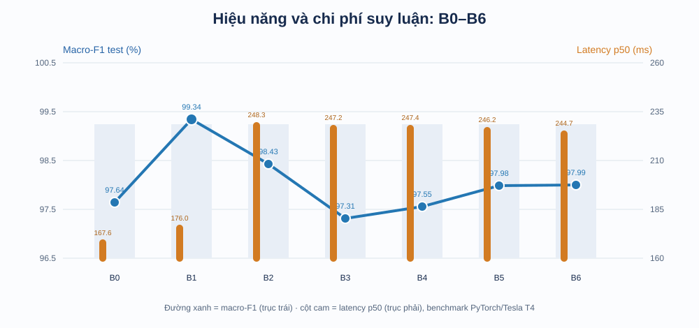
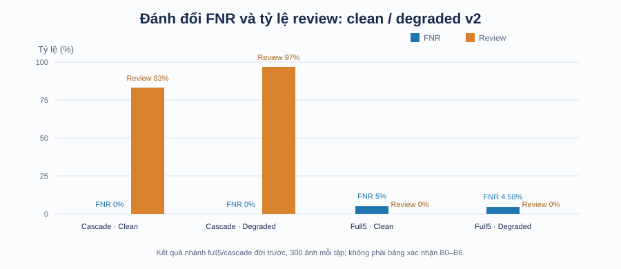

# Báo cáo tổng quan tiến độ dự án phân loại khuyết tật ống hút

**Ngày tổng hợp:** 21/10/2026  
**Phạm vi:** Nhánh nghiên cứu phân loại ảnh ống hút trên hộp đồ uống. Báo cáo này không gộp kết quả từ nhánh phân đoạn khuyết tật nhôm ANI/3CAD.

## Tóm tắt nhanh

Dự án đã đi từ kiểm kê dữ liệu và dựng pipeline huấn luyện đến đánh giá khóa mô hình, benchmark và nguyên mẫu suy luận băng chuyền. Kết quả khoa học mạnh nhất hiện tại là baseline ảnh toàn cục ResNet18 ở 512 px (B1), đạt **macro-F1 99,34%** và accuracy **99,33%** trên test nội bộ 299 ảnh. Mô hình global-local nhiều thành phần nhất (B6) đạt macro-F1 **97,99%**; so sánh paired với B1 cho thấy B6 thấp hơn **1,35 điểm phần trăm**. Vì vậy, thử nghiệm hiện tại chưa chứng minh global-local cải thiện baseline.

Đã có demo TensorRT/DeepStream và băng chuyền canvas; nhưng dữ liệu suy giảm và camera thật chưa được xác nhận đủ để kết luận sẵn sàng vận hành. Các chỉ số clean test, degraded test, RTSP replay và demo thuộc checkpoint/protocol khác nhau, nên được báo riêng.

## Tiến trình theo từng bước

| Bước | Việc đã làm | Kết quả | Tối ưu / ý nghĩa |
|---|---|---|---|
| 1. Kiểm kê và khóa dữ liệu | Audit 2.000 ảnh, 5 lớp, 8 thương hiệu; lập manifest, hash, group và split train/validation/test | Split xác nhận: 1.401 / 300 / 299 ảnh; test nội bộ đã khóa | Giảm nguy cơ trùng mẫu qua split, phát hiện các cặp gần giống; fingerprint giúp truy nguyên cấu hình. Dataset vẫn cần bổ sung nguồn/quyền sử dụng và rà nhóm thủ công. |
| 2. Dựng pipeline nghiên cứu | Tách module dữ liệu, model, runner, đánh giá và đóng gói Kaggle; hỗ trợ resume và kiểm soát provenance | Có pilot, smoke run và gói chạy Kaggle; smoke chỉ chứng minh kỹ thuật, không phải kết quả khoa học | Có thể tiếp tục phiên train bị ngắt; chọn checkpoint theo validation; tránh dùng test để chỉnh mô hình. |
| 3. Thiết kế đối chứng B0–B6 | So sánh ảnh 224/512, global/local crop, mean pooling, attention, ngữ cảnh global và tọa độ | 7 cấu hình × 3 seed = 21 run; tất cả có test output | Tách ảnh hưởng từng thành phần để kiểm tra giả thuyết thay vì mặc định mô hình phức tạp hơn sẽ tốt hơn. |
| 4. Freeze và đánh giá | Khóa checkpoint/protocol, tổng hợp macro-F1, accuracy, FNR/FPR và paired bootstrap B6−B1 | B1 đứng đầu; B6 thấp hơn B1; kết quả trên cùng 299 ảnh test cho cả ba seed | Báo mean ± SD theo seed và CI paired theo nhóm ảnh; không coi 3 seed là 3 test set độc lập. |
| 5. Đo chi phí | Benchmark batch 1 trên Tesla T4, gồm decode, tạo view, chuẩn hóa, transfer và forward | B0 p50 167,64 ms; B1 175,95 ms; nhóm nhiều view khoảng 244,74–248,30 ms | Đo end-to-end để thấy chi phí crop nhiều view; B0 nhanh nhất trong benchmark PyTorch này. |
| 6. Nguyên mẫu triển khai | Chuyển mô hình nhánh triển khai sang ONNX/TensorRT/DeepStream; dựng RTSP replay, worker thường trú và pixel gate trên canvas | Replay DeepStream: macro-F1 99,016% trên 300 ảnh validation; RTSP replay 31,03 FPS; canvas smoke 3/3 event và inference | Nạp worker một lần, chỉ gọi CNN khi track qua ROI; giảm suy luận từng frame. Đây là bằng chứng replay/mô phỏng, chưa phải camera/PLC thật. |
| 7. Kiểm toán robustness và sửa dữ liệu | Rà lô Bent 30 ảnh và bộ degraded cũ; sửa định danh ảnh để tránh ghi đè, tạo degraded v2, sửa xử lý EXIF | Lô Bent cũ 18/30 đúng (60%), nhưng ảnh bị xoay 90° do bỏ qua EXIF và app chạy B1 384, không phải B1 512. Degraded v2 có 300 ảnh duy nhất cho validation và test | Kết quả 60% bị loại khỏi kết luận robustness. Degraded v2 được đánh giá riêng; cần chạy lại B1 512 trên đầu vào chuẩn hóa đúng. |

## Bảng kết quả xác nhận B0–B6

Các số dưới đây là mean ± SD (%) trên 3 seed, cùng test khóa 299 ảnh (241 lỗi, 58 tốt). Đây là test nội bộ, không phải tập độc lập từ nhà máy.

| Model | Cấu hình tóm tắt | Macro-F1 | Accuracy | FNR lỗi→tốt | FPR tốt→lỗi | p50 end-to-end (ms) |
|---|---|---:|---:|---:|---:|---:|
| B0 | Global 224 | 97,64 ± 0,67 | 97,66 ± 0,67 | 1,80 ± 0,24 | 1,15 ± 1,00 | **167,64** |
| B1 | Global 512 | **99,34 ± 0,00** | **99,33 ± 0,00** | **0,41 ± 0,00** | **0,00 ± 0,00** | 175,95 |
| B2 | 4 local crop, mean | 98,43 ± 0,86 | 98,44 ± 0,84 | 0,55 ± 0,24 | 0,57 ± 1,00 | 248,30 |
| B3 | Global 224 + local mean | 97,31 ± 0,00 | 97,32 ± 0,00 | 1,66 ± 0,41 | 0,00 ± 0,00 | 247,19 |
| B4 | Global + local attention | 97,55 ± 1,07 | 97,55 ± 1,08 | 1,94 ± 1,57 | 1,15 ± 1,00 | 247,36 |
| B5 | Attention có điều kiện global | 97,98 ± 1,21 | 97,99 ± 1,21 | 1,11 ± 1,20 | 0,00 ± 0,00 | 246,24 |
| B6 | B5 + tọa độ crop | 97,99 ± 0,89 | 97,99 ± 0,88 | 1,24 ± 0,72 | 1,72 ± 0,00 | 244,74 |

**So sánh chính:** B6 − B1 = **−1,35 điểm macro-F1**, CI 95% paired group bootstrap **[−2,63; −0,32]** (1.000 lần lấy mẫu). Kết quả ủng hộ B1 trong protocol/dataset hiện tại; không chứng minh kết quả sẽ giữ nguyên trên camera hoặc nhà máy khác.

*Biểu đồ dùng macro-F1 test và p50 end-to-end từ benchmark PyTorch trên Tesla T4; latency không phải số đo TensorRT của demo.*

## Kết quả ảnh suy giảm và triển khai — đọc riêng với bảng trên

| Nhánh / tập | Kết quả ghi nhận | Cách diễn giải |
|---|---|---|
| Full5, Clean | FNR 5,00%; FPR 30,00%; review 0% | Checkpoint nhánh phân loại trước, không phải B0–B6. |
| Full5, Degraded v2 | FNR 4,58%; FPR 48,33%; review 0% | Nhạy với ảnh suy giảm, đặc biệt false positive cao; không gộp với clean test B0–B6. |
| Cascade 2 tầng, Clean | FNR 0%; review 83% | Giảm bỏ sót bằng cách đẩy phần lớn mẫu sang review; chi phí mô phỏng cao. |
| Cascade 2 tầng, Degraded v2 | FNR 0%; review 97% | Chưa phù hợp vận hành do review gần như toàn bộ. |
| TensorRT/DeepStream replay | Macro-F1 99,016%; accuracy 99,000% trên 300 frame validation | Checkpoint cũ và backend khác; có một dự đoán lệch so với PyTorch trên clip. |
| RTSP replay | 252 frame; 31,03 FPS; first prediction 1,31 s | Clip phát lại ảnh tĩnh; không đại diện throughput camera thực. |
| Pixel gate canvas | Smoke 3 sản phẩm → 3 event → 3 inference | Xác nhận luồng demo ở mô phỏng nhỏ, chưa đánh giá recall/false trigger trên video có nhãn. |

*FNR thấp của cascade đi kèm tỷ lệ review rất cao. Chi phí trong hồ sơ gốc là ước lượng theo giả định, không phải chi phí tiền thực.*

## Tối ưu đã thực hiện

- **Tính tái lập:** manifest có sample ID/hash/group; protocol và config có fingerprint; lưu checkpoint, log, prediction và trạng thái resume.
- **Tính công bằng của so sánh:** dùng cùng split, class order và ba seed; chọn model bằng validation trước khi đánh giá test.
- **Tách tác động kiến trúc:** B0–B6 tăng dần độ phân giải, local views và các dạng attention để biết thành phần nào có ích.
- **Tối ưu đường suy luận:** worker TensorRT thường trú, warmup, tái sử dụng context/buffer; gate pixel lọc frame và kích hoạt inference theo ROI.
- **Chất lượng dữ liệu suy giảm:** tránh ghi đè ảnh do trùng tên bằng định danh có thương hiệu/hash; khắc phục orientation EXIF cho bộ sinh mới.
- **Kết luận dựa trên chi phí:** B1 đạt điểm cao nhất, B0 nhanh nhất; nhiều view tăng p50 khoảng 69–81 ms so với B0 trong benchmark đã ghi.

## Các việc còn lại theo mức ưu tiên

| Ưu tiên | Việc cần làm | Vì sao cần |
|---|---|---|
| 1 | Thay placeholder người rà soát/notes trong freeze ledger bằng biên bản thật; rà nhãn và các nhóm ảnh gần nhau | Hoàn thiện tính kiểm chứng trước khi dùng số liệu làm bằng chứng chính thức. |
| 2 | Ghi nguồn dataset, quyền sử dụng/chia sẻ và định nghĩa nhãn gốc, nhất là `loose`/`pierced` | Tránh nhầm nghĩa nhãn và xác nhận quyền sử dụng trong báo cáo/nộp bài. |
| 3 | Sinh degraded Bent đúng chiều; xác nhận SHA của B1 512; đánh giá lại cùng protocol | Đo robustness hợp lệ sau khi loại lỗi EXIF và lệch checkpoint. |
| 4 | Thu video camera có nhãn và đo gate recall, false trigger/phút, latency ROI→kết quả; kiểm tra PLC nếu có | Xác nhận bước demo có chạy được trong điều kiện vật lý. |
| 5 | Hoàn tất related work, phân tích lỗi/ma trận nhầm lẫn và bổ sung bất định cho các so sánh phụ | Trả lời đủ câu hỏi nghiên cứu và giới hạn tuyên bố novelty. |

## Kết luận điều hành

Hiện dự án **đã hoàn tất thực nghiệm xác nhận 21 run B0–B6** và có một nguyên mẫu triển khai để minh họa pipeline. Kết quả test nội bộ hiện chọn B1 512 làm cấu hình tốt nhất; các ablation global-local không vượt baseline B1, trong khi tốn thêm thời gian suy luận. Độ tin cậy về khả năng chạy thực tế còn thiếu kiểm chứng degraded đúng chiều, rà soát dữ liệu/thủ công, và video camera có nhãn. Vì vậy có thể trình bày dự án là **đã hoàn thành nghiên cứu mô hình trên protocol nội bộ và đã có demo kỹ thuật**, chưa nên gọi là hệ thống sẵn sàng sản xuất.

## Tài liệu để truy sâu

- Báo cáo nghiên cứu đầy đủ: [BAO_CAO_TONG_QUAN_KHOA_LUAN_ONG_HUT.md](BAO_CAO_TONG_QUAN_KHOA_LUAN_ONG_HUT.md)
- Kết quả và quy trình xác nhận: [STRAW_GLOBAL_LOCAL_VERIFICATION.md](STRAW_GLOBAL_LOCAL_VERIFICATION.md), [STRAW_GLOBAL_LOCAL_RUNBOOK.md](STRAW_GLOBAL_LOCAL_RUNBOOK.md)
- Hồ sơ triển khai thời gian thực: [STRAW_REALTIME_OPTIMIZATION.md](STRAW_REALTIME_OPTIMIZATION.md), [STRAW_RTSP_DEEPSTREAM.md](STRAW_RTSP_DEEPSTREAM.md), [STRAW_INTELLIGENT_INFERENCE_GATE.md](STRAW_INTELLIGENT_INFERENCE_GATE.md)
- Artifact xác nhận: `straw_resume/artifacts/straw_global_local/confirmatory_kaggle_v1/report/`
- Hồ sơ báo cáo định dạng Word/PDF hiện có: `submission/01_report/`
